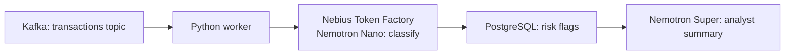
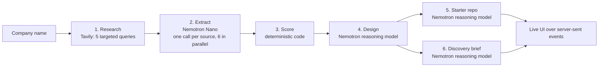

# POCForge

**A prospect's stack in, a working integration out.**

POCForge turns a company name into the first week of a forward-deployed engineer's work. It researches the company's public engineering footprint, infers its technology stack with a cited source for every claim, designs how a vendor product fits into that stack, generates a runnable starter repository, and writes the technical discovery questions for the first customer call.

It runs on **NVIDIA Nemotron** models served by **Nebius Token Factory**, with web research by **Tavily**.

> Built for the **Nebius x NVIDIA Global AI Hackathon**, Best Apps and Agents track.

---

## The problem

Forward-deployed engineers (FDEs) and solutions engineers start every new customer the same way:

1. Work out what the customer actually runs: languages, databases, streaming, cloud, data platform.
2. Figure out where the product fits in that architecture, and what could go wrong.
3. Build a proof of concept against a stack that looks like theirs.
4. Prepare sharp technical questions for the first call.

This takes days per prospect, and most of it is reading engineering blogs, job posts and conference talks. Sales demo tools personalise click-through product tours; none of them produce the engineering artefacts an FDE needs. POCForge automates exactly that engineering work, and it shows its evidence so the engineer can trust or correct every conclusion.

## What you get

For one company name, POCForge produces five outputs:

| Output | What it contains |
|---|---|
| **Inferred stack** | Every technology the company uses, with a confidence level (high, medium, low), the number of supporting sources, and a quoted piece of evidence linked to each source |
| **Integration design** | A summary, 2–3 use cases tied to the company's real systems, a Mermaid architecture diagram, risks with mitigations, and every assumption labelled *confirmed* or *guess* |
| **Starter repo** | A downloadable zip: `docker-compose.yml` with local stand-ins for the company's key systems, a Python app that calls Nebius Token Factory, realistic sample data, a Dockerfile, `.env.example` and a README |
| **Discovery brief** | 8–10 technical questions aimed at the assumptions the evidence could not confirm, each with the reason it matters. One-click copy |
| **Agent trace and cost** | Every pipeline stage with its model, timing, the sources read or skipped, and the token count and cost per model tier |

### Illustrative output

The example below uses a fictional company to show the format of each output.

**Inferred stack**
```
high    3.5  Kafka         [streaming]  ×3   "events flow through Kafka topics into…"   eng-blog, jobs
high    2.5  PostgreSQL    [database]   ×2   "our ledger runs on PostgreSQL"            eng-blog, talk
medium  1.5  Go            [language]   ×2   "backend services are written in Go"       jobs
low     0.5  Snowflake     [data]       ×1   "experience with Snowflake a plus"         jobs
```

**Integration design (diagram)**


**Discovery brief**
```
01  Which identity provider fronts your internal services, and can workers use service accounts?
    Why: no public source confirms the auth provider; it decides how the worker authenticates.
02  Are Kafka topics retained long enough to backfill 30 days of history?
    Why: the fraud use case needs history; retention is not stated publicly.
```

**Starter repo**
```
acme-payments-poc/
├── README.md
├── docker-compose.yml     # postgres, apache/kafka, app
├── Dockerfile
├── requirements.txt
├── .env.example           # NEBIUS_API_KEY, MODEL_FAST, MODEL_REASON
├── app/main.py            # consumes Kafka, calls Token Factory, writes to Postgres
└── app/seed.py            # realistic sample transactions, no real data
```
```bash
unzip acme-payments-poc.zip && cd acme-payments-poc && cp .env.example .env && docker compose up
```

---

## How it works



| # | Stage | Engine | Details |
|---|---|---|---|
| 1 | Research | Tavily search (advanced depth) | Five queries per company: engineering blog (architecture), engineering blog (data platform), job postings, GitHub, conference talks. Results are de-duplicated by normalised URL. |
| 2 | Extract | **Nemotron Nano** on Token Factory | One JSON-mode call per source, up to 6 in parallel. The model must decide whether the source is about the company's *own* engineering, skip vendors and other companies, and quote its evidence. |
| 3 | Score | Code | Merges aliases (`postgres` → PostgreSQL, `k8s` → Kubernetes), counts each source once, weights *stated* (1.0) over *implied* (0.5), and adds a bonus when different kinds of source agree. Score ≥ 2.5 is high confidence, ≥ 1.5 medium. |
| 4 | Design | **Nemotron reasoning model** (Super / Ultra) | Grounded in the scored stack only; anything not in the evidence must be marked as a guess. |
| 5 | Starter repo | **Nemotron reasoning model** | Generated as plain-text file blocks, then parsed, path-checked and validated (must contain a compose file). |
| 6 | Discovery brief | **Nemotron reasoning model** | Targets low-confidence technologies, guessed assumptions and categories with no evidence at all. Runs in parallel with stage 5. |

If every extraction call fails, the pipeline stops before stage 4 so no reasoning tokens are spent on an empty stack. A failed repo or brief is reported in the trace without discarding the rest of the run.

---

## How we use NVIDIA Nemotron on Nebius Token Factory

### Two-tier model routing

POCForge routes each task to the cheapest model that can do it well:

| Tier | Model | Used for | Why |
|---|---|---|---|
| `fast` | **Nemotron 3 Nano** (30B total, ~3B active) | Per-source stack extraction: 20–30 calls per run | High volume, structured JSON, short context; speed and cost matter most |
| `reason` | **Nemotron 3 Super / Ultra** | Integration design, code generation, discovery brief: 3 calls per run | Needs real reasoning over the whole stack and correct multi-file code |

This is the split the hackathon recommends: reasoning models for the hard calls, Nano for the fast everyday ones. The cost panel in the UI shows the split live, so the effect of the routing is visible on every run.

### Integration details

- **OpenAI-compatible API.** Token Factory exposes `https://api.tokenfactory.nebius.com/v1/`, so the app uses the official `openai` SDK with a different `baseURL`. Switching models is a configuration change, not a code change.
- **Configurable model IDs.** Model IDs are case-sensitive, so they live in environment variables (`MODEL_FAST`, `MODEL_REASON`). `npm run smoke` lists the exact Nemotron IDs available to your key.
- **JSON mode with schema validation.** Extraction, design and brief calls use `response_format: json_object`, then validate with Zod. Fields that come back malformed fall back to safe defaults instead of failing the run.
- **Reasoning-model output handling.** Reasoning models may wrap answers in `<think>` blocks or code fences. The parser strips both before reading the JSON.
- **Per-call accounting.** Every call records model, latency, input and output tokens, and cost (from per-tier prices in the environment). Totals are streamed to the UI per tier.
- **Generated code uses Token Factory too.** Every starter repo calls Token Factory with keys and model IDs read from its own `.env`, so the proof of concept a prospect runs is itself a Token Factory integration.

### Where Token Factory accelerated the work

- No GPU provisioning or model hosting: both Nemotron tiers are available through a single API key.
- The OpenAI-compatible endpoint means no custom client code, and the same SDK serves both tiers.
- Nano and the reasoning models sit side by side on one platform, so the routing design is a configuration choice that can be compared run by run.

### How we use Tavily

Tavily is the agent's eyes on the public web. Each run makes five targeted searches at advanced depth and feeds the returned content straight into Nemotron Nano. Every claim in the inferred stack links back to the Tavily result it came from.

---

## The interface

- **Landing page:** one input, plus one-click examples.
- **Agent trace (sidebar):** each stage with a status light, its engine badge (Tavily, Nemotron Nano, Nemotron reasoning, code), the stage detail and elapsed time; below it, every source with its kind, whether it was read, skipped as off-topic or failed, and how many technologies it yielded.
- **Model routing and cost (sidebar):** calls, tokens, model time and cost for each tier, and the total.
- **Main column:** stack cards that expand to show quoted evidence and source links; the integration design with a live-rendered diagram; the repo viewer with a file tree, code view and zip download; and the discovery brief with a copy button.

Results stream in over server-sent events as each stage finishes, so the user watches the agent work instead of waiting on a spinner.

---

## Getting started

### Requirements

- Node.js 20 or newer
- A Nebius Token Factory API key ([tokenfactory.nebius.com](https://tokenfactory.nebius.com))
- A Tavily API key ([app.tavily.com](https://app.tavily.com))
- Docker, to run the generated starter repos

### Setup

```bash
git clone <this-repo-url> pocforge
cd pocforge
npm install
cp .env.example .env.local      # add NEBIUS_API_KEY and TAVILY_API_KEY
npm run smoke                   # lists your Nemotron model IDs and tests both tiers and Tavily
npm run dev                     # open http://localhost:3000
```

### Configuration

| Variable | Purpose |
|---|---|
| `NEBIUS_API_KEY` | Token Factory API key |
| `NEBIUS_BASE_URL` | Defaults to `https://api.tokenfactory.nebius.com/v1/` |
| `MODEL_FAST` | Nemotron Nano model ID |
| `MODEL_REASON` | Nemotron Super or Ultra model ID |
| `PRICE_FAST_IN`, `PRICE_FAST_OUT`, `PRICE_REASON_IN`, `PRICE_REASON_OUT` | USD per 1M tokens, for the cost panel |
| `TAVILY_API_KEY` | Tavily API key |

### Command line

```bash
npm run pipeline -- "Company"                   # full run; the starter repo is written to out/<company>/
npm run pipeline -- "Company" --stack-only      # research, extraction and scoring only
npm run pipeline -- "Company" --research-only   # Tavily only, no model calls
```

### Quality checks

```bash
npm test          # unit tests: alias merging, scoring, JSON parsing, file-block parsing, path safety
npm run lint
npm run build
```

---

## Project structure

```
src/
├── app/
│   ├── page.tsx                 # the single-page UI
│   ├── api/run/route.ts         # POST { company } → server-sent event stream
│   └── api/dev-fixture/route.ts # development-only replay for UI work (404 in production)
├── components/                  # Trace, StackView, DesignView, Mermaid, RepoView, BriefView, CostPanel
└── lib/
    ├── llm.ts                   # Token Factory client, tiers, JSON parsing, per-call stats
    ├── tavily.ts                # research queries and URL de-duplication
    ├── stack.ts                 # Nano extraction prompt, alias merging, scoring
    ├── stages.ts                # design, repo generation, discovery brief
    ├── pipeline.ts              # orchestration, concurrency, totals
    ├── product.ts               # the vendor product profile (Nebius Token Factory by default)
    ├── runState.ts              # UI state reducer and event-stream reader
    └── types.ts                 # shared types and pipeline events
scripts/
├── smoke.mjs                    # connectivity and model-ID check
└── run.mts                      # command-line runner
tests/                           # node:test unit tests
```

---

## Design decisions

- **Evidence first.** Every technology carries quoted evidence and a source link, and every design assumption is labelled confirmed or guess. An FDE can check any conclusion in one click instead of trusting the model.
- **Cheap model wide, expensive model narrow.** Extraction is many small, independent, structured tasks, so it goes to Nano in parallel. Only the three tasks that need whole-picture reasoning go to the large model.
- **Deterministic scoring.** Confidence comes from code, not from the model's opinion, so it is explainable and testable.
- **File blocks instead of JSON for code.** Multi-file code inside JSON strings breaks escaping too often. The model writes `=== FILE: path ===` blocks, which are parsed and checked.
- **Defensive handling of generated code.** File paths are restricted to relative paths with no `..`, no absolute paths and no hidden files except `.env.example`. File count and size are capped. Mermaid diagrams render with `securityLevel: "strict"`. Generated code never contains keys.
- **Swappable product.** The vendor being integrated is a profile in `product.ts`. Nebius Token Factory is the default; any API product can be described the same way.

## Responsible use

- Public sources only: no logged-in scraping, no private data.
- No personal data about employees is extracted or stored; the pipeline looks for technologies, not people.
- Generated sample data is synthetic.
- Every inference is labelled with its evidence and confidence, so guesses are never presented as facts.

---

## What we learned

- **Relevance filtering matters as much as extraction.** Live searches for a company's stack returned vendor case studies, fan-made clones on GitHub and news about other companies. That is why Nano first decides whether a source is about the company's *own* engineering before listing any technology.
- **Shape tasks to suit small models.** One source in, one JSON object out, with a strict schema and a short context: this keeps each Nano call narrow, independent and cheap, which is what makes parallel extraction practical.
- **Structure the output to suit the content.** JSON works for facts and lists; plain-text blocks work far better for multi-file code.
- **Fail early when the model is unreachable.** A run where every extraction fails should stop immediately rather than send an empty stack to the most expensive model.
- **SDK compatibility pays off.** Because Token Factory speaks the OpenAI API, upgrading to the current `openai` SDK (v6, which supports Zod 4) needed no changes to the client code.
- **Model IDs are case-sensitive.** Listing models from the API, rather than copying names from articles, avoids a whole class of configuration errors.

---

## Roadmap

### Next
- **Run caching.** Cache completed runs by company so repeat views and demos cost nothing.
- **Shareable reports.** A permanent link to a run's stack, design, repo and brief to send to teammates.
- **Repo boot check.** Start each generated repo in a sandbox (Nebius Serverless Jobs) and attach a pass/fail badge before the user downloads it.
- **Rate limiting** per user for public deployments.

### Later
- **Bring your own product.** Paste product docs or an OpenAPI spec to generate the product profile automatically.
- **Deeper evidence.** Read public GitHub organisations, package manifests and status pages for higher-confidence signals.
- **Stack change tracking.** Re-run on a schedule and alert the account team when a prospect adopts or drops a technology.
- **CRM and ticketing export.** Push the brief and design into Salesforce, HubSpot, Linear or Jira.
- **Evaluation set.** A labelled set of companies with known stacks, to measure extraction precision and recall per model and tune the Nano / Super / Ultra split with data.
- **Fine-tuned extractor.** Use the evaluation set to fine-tune Nano on Token Factory for higher extraction accuracy at the same cost.

---

## Built with

- [NVIDIA Nemotron](https://www.nvidia.com/en-us/ai-data-science/foundation-models/nemotron/) 3 Nano and Super / Ultra
- [Nebius Token Factory](https://tokenfactory.nebius.com)
- [Tavily](https://tavily.com)
- Next.js 15, React 19, TypeScript, Tailwind CSS 4, Zod 4, Mermaid, JSZip

## License

[MIT](LICENSE)
